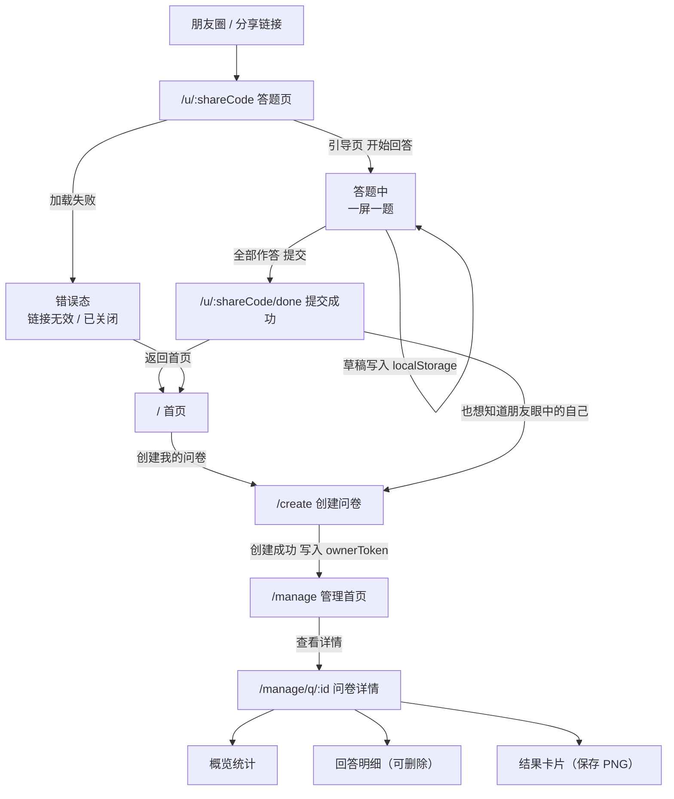

# 印象问答 · 页面结构设计

关联：`01-产品需求文档.md`、`04-API接口清单.md`

---

## 1. 设计原则

1. **移动优先**。90% 的访问来自朋友圈 → 手机。先设计 320–430px 宽度的体验，桌面端只是「居中加宽」。
2. **一屏一决策**。答题页一屏一题，减少滚动和认知负担。
3. **零等待感知**。按钮点击后立刻有状态反馈（loading / disabled），不能让人怀疑「点了没反应」。
4. **不做组件库**。第一版手写 CSS（CSS 变量做主题），依赖越少，体积越小，也更能学会 CSS。

---

## 2. 站点地图

```
印象问答
├── /                          首页（产品介绍 + 创建入口）
├── /create                    创建问卷
├── /u/:shareCode              答题者入口
│     ├── (内联状态) 引导 → 答题 → 提交中
│     └── /done                提交成功 + 传播入口
├── /manage                    创建者管理首页（问卷列表）
│     └── /q/:id               单问卷详情
│            ├── 概览统计
│            ├── 回答明细
│            └── 结果卡片
└── /:pathMatch(.*)*           404
```

---

## 3. 路由表

| 路由 | 页面组件 | 访问角色 | 鉴权方式 | 说明 |
|---|---|---|---|---|
| `/` | `HomeView` | 所有人 | 无 | 产品介绍，主 CTA 是「创建我的印象问卷」 |
| `/create` | `CreateView` | 访客 | 无 | 填标题 + 描述（第一版题目用预置题库），创建后跳 `/manage` |
| `/u/:shareCode` | `QuizView` | 答题者 | 无 | 用 `shareCode` 拉取问卷；内部含引导 / 答题 / 提交三态 |
| `/u/:shareCode/done` | `QuizDoneView` | 答题者 | 无 | 提交成功反馈 + 传播入口 |
| `/manage` | `ManageView` | 创建者 | `ownerToken`（localStorage，可用 `?token=` 覆盖） | 列出我创建的问卷 |
| `/manage/q/:id` | `QuestionnaireDetailView` | 创建者 | `ownerToken` | 统计 / 明细 / 结果卡片 |
| `/:pathMatch(.*)*` | `NotFoundView` | 所有人 | 无 | 404 |

**关于创建者凭证（第一版不引入账号体系的替代方案）**

- 创建问卷成功后，后端返回 `ownerToken`，前端存入 `localStorage`（key：`impression.ownerToken`）。
- 后续所有管理请求带上 `X-Owner-Token` 头。
- 支持 `http://域名/manage?token=xxx` 直接在别的设备打开（用于换手机 / 备份）。
- 页面上提供「我的管理链接」一键复制，提醒用户保存——**丢了就找不回来**，这是第一版刻意接受的代价。

---

## 4. 页面详细结构

### 4.1 `/` 首页 `HomeView`

| 区块 | 内容 | 交互 |
|---|---|---|
| Hero | 主标题「你眼中的我，是什么样的人？」、副标题「把链接发给朋友，1 分钟，匿名，看看他们眼中的你」 | 主按钮「创建我的印象问卷」→ `/create` |
| 玩法 | 三步图示：① 发链接给朋友 ② 朋友回答 8–10 题 ③ 收到印象报告 | 静态 |
| 示例卡片 | 一张结果卡片预览图（静态假数据） | 静态 |
| 隐私说明 | 一行字：不采集身份信息、开放题可跳过、创建者可随时删除回答 | 静态 |
| Footer | 项目说明 · GitHub 链接 | 外链 |

**状态**：纯静态，无 loading / 空态。

---

### 4.2 `/create` 创建问卷 `CreateView`

| 区块 | 内容 |
|---|---|
| 表单 | 标题（必填，≤ 30 字）、描述（选填，≤ 100 字） |
| 说明 | 「第一版使用一套预置题库，共 9 道题，后续会开放自定义出题」 |
| 提交 | 「生成我的问卷」按钮；成功后写入 ownerToken → 跳 `/manage` |

**状态**

- 校验失败：字段下方红字提示（标题为空 / 超长）
- 提交中：按钮 loading + 禁用，防重复点击
- 提交失败：Toast 提示，保留表单内容

---

### 4.3 `/u/:shareCode` 答题页 `QuizView`

这是一个**状态机页面**，四种形态：

```
loading → intro → answering → submitting → (跳转 done)
             ↘ error（问卷不存在 / 已关闭 / 网络异常）
```

#### 状态 1：loading
骨架屏或居中转圈。

#### 状态 2：intro（引导）
| 元素 | 说明 |
|---|---|
| 标题 | `{创建者名}想知道，你眼中的他是什么样的人？` |
| 说明 | 「一共 9 道题，大约 1 分钟」 |
| 隐私提示 | 「回答会展示给 {创建者名}，我们不会记录你的身份信息」 |
| 主按钮 | 「开始回答」 |

#### 状态 3：answering（答题）
| 元素 | 说明 |
|---|---|
| 顶部进度 | `第 3 / 9 题` + 进度条 |
| 题干 | 题目文本（必填题带 `*`） |
| 作答区 | 按题型渲染，见下表 |
| 底部操作 | 「上一题」（第 1 题禁用）／「下一题」；最后一题变为「提交」 |
| 草稿 | 每次作答写入 localStorage（key：`impression.draft.{shareCode}`），刷新不丢 |

**题型 → 组件映射**

| 题型 | 组件 | 交互细节 |
|---|---|---|
| 单选 | `SingleChoiceCard` | 整块卡片可点；选中态高亮；点击即选中，不自动跳题（避免误触） |
| 多选 | `MultiChoiceCard` | 最多选 3 项；达到上限时其余选项置灰并提示「最多选 3 项」 |
| 开放题 | `OpenTextCard` | textarea，右上角字数 `12 / 200`；提供「跳过此题」按钮 |

**校验规则**：必填题未作答时点「下一题」，弹出 Toast 并高亮题干，**不跳转**。

#### 状态 4：error
| 场景 | 文案 |
|---|---|
| 分享码不存在 | 「链接无效，请确认后重试」+ 返回首页 |
| 问卷已关闭 | 「这份问卷已经停止收集了」+ 返回首页 |
| 网络异常 | 「网络开小差了」+ 重试按钮 |

---

### 4.4 `/u/:shareCode/done` 提交成功 `QuizDoneView`

| 区块 | 内容 | 交互 |
|---|---|---|
| 成功反馈 | 对勾图标 + 「已收到你的印象，谢谢！」 | — |
| 结果提示 | 样本 < 3 时不显示任何结论，只显示「{创建者名}已经收到了你的回答」 | — |
| 传播卡片 | 「也想知道朋友眼中的自己？」 | 按钮「创建我的印象问卷」→ `/create` |
| 次要操作 | 「返回首页」 | → `/` |

---

### 4.5 `/manage` 管理首页 `ManageView`

| 区块 | 内容 |
|---|---|
| 顶部 | 标题「我的问卷」+ 按钮「新建问卷」 |
| 列表 | 每行：标题、状态标签（进行中 / 已关闭）、提交数、创建时间 |
| 行操作 | 复制分享链接 / 查看详情 / 关闭-开启 / 删除 |

**状态**

| 状态 | 表现 |
|---|---|
| 无 ownerToken | 提示「请输入你的管理凭证」，输入框 + `?token=` 也可直接进入 |
| 加载中 | 列表骨架屏 |
| 空（未创建过） | 空状态插画 + 「创建我的第一份问卷」按钮 |
| 凭证失效 | 「凭证无效」+ 重新输入入口 |

---

### 4.6 `/manage/q/:id` 问卷详情 `QuestionnaireDetailView`

| 区块 | 内容 |
|---|---|
| 头部 | 问卷标题、状态开关、「复制分享链接」按钮、「我的管理链接」按钮 |
| 样本量提示 | 「已收到 18 份回答」；`< 3` 时显示黄色警示条：「样本较少，结论仅供参考」 |
| Tab 1 概览统计 | 每题一个 `BarChart`：选项 + 票数 + 占比条；开放题显示「共 12 条回答」 |
| Tab 2 回答明细 | 按提交时间倒序分组；每组显示时间 + 各题答案（开放题原文）；右上角「删除这条」 |
| Tab 3 结果卡片 | 卡片实时预览 + 「保存图片」按钮（canvas → PNG 下载） |

**分页**：回答明细按 10 条/页。

---

### 4.7 `/:pathMatch(.*)*` 404 `NotFoundView`

「页面不存在」+ 「返回首页」按钮。

---

## 5. 移动优先设计规范

| 项 | 规范 |
|---|---|
| 布局宽度 | 答题页 / 结果页：容器 `max-width: 480px` 居中；管理页：`max-width: 960px` |
| 断点 | `< 768px` 移动（默认）；`768–1024px` 平板；`> 1024px` 桌面 |
| 最小宽度 | 320px 不出现横向滚动 |
| 字号 | 正文 ≥ 16px（小于 16px 时 iOS 会自动放大输入框） |
| 可点击区域 | 高度 ≥ 44px |
| 底部安全区 | `padding-bottom: env(safe-area-inset-bottom)` |
| 主题变量 | `--color-primary` / `--color-text` / `--color-bg` / `--radius-card` / `--space-unit` |
| 动效 | 只用于状态切换（200ms 内），不做装饰性动画 |

---

## 6. 组件清单

| 组件 | 类型 | 职责 |
|---|---|---|
| `AppShell` | 布局 | 页面容器、顶部栏、底部安全区 |
| `ProgressBar` | 展示 | 答题进度 |
| `QuestionCard` | 容器 | 接收题目对象，按 `type` 分发到具体题型组件 |
| `SingleChoiceCard` / `MultiChoiceCard` / `OpenTextCard` | 表单 | 三种题型的作答 UI |
| `OptionItem` | 表单 | 单个选项（选中态、禁用态） |
| `PrimaryButton` / `GhostButton` | 基础 | 主 / 次按钮，内置 loading 与 disabled |
| `Toast` | 反馈 | 轻量提示 |
| `EmptyState` / `ErrorState` / `SkeletonBlock` | 状态 | 空态 / 错误态 / 加载态 |
| `BarChart` | 展示 | 纯 CSS 实现的选项分布条 |
| `SampleSizeNotice` | 展示 | 样本量不足的警示 |
| `AnswerItem` | 展示 | 单条回答的展示与删除 |
| `ResultCard` | 展示 | 结果卡片预览（DOM） |
| `resultCardRenderer` | 工具 | canvas 绘制并导出 PNG |
| `CopyButton` | 基础 | 复制文本 + 复制成功反馈 |

---

## 7. 状态管理划分

用 **Pinia**，只放真正需要跨组件共享的状态，其余用组件内 `ref`。

| Store | 状态 | 持久化 |
|---|---|---|
| `useOwnerStore` | `ownerToken`、`questionnaires[]` | `localStorage` |
| `useQuizStore` | `currentIndex`、`answers{}`、`shareCode` | `localStorage`（按 shareCode 分键） |

**不放 Store 的东西**：接口请求结果（组件内请求即可）、表单临时输入、Toast 状态。

**接口层**：统一封装一个 `src/api/request.js`（Axios 实例）

- 自动附加 `X-Owner-Token`
- 统一解包 `{ code, message, data }`
- 非 0 code 统一抛错 → 由调用方决定用 Toast 还是错误页
- 关键：**在拦截器里判定 401/403 时清除失效凭证并引导重新输入**

---

## 8. 页面流转图



---

## 9. 待确认项（开发前需要拍板）

1. 答题是「一屏一题」还是「一屏滚动全部」？**当前方案：一屏一题**（利于移动端与埋点，但需要多一次用户操作）。
2. 结果卡片第一版是「固定模板」还是「可换模板」？**当前方案：固定 1 套模板**。
3. 答题者提交后是否能看到聚合结果？**当前方案：看不到**，只看到成功页与传播入口（避免样本不足时产生误导）。
