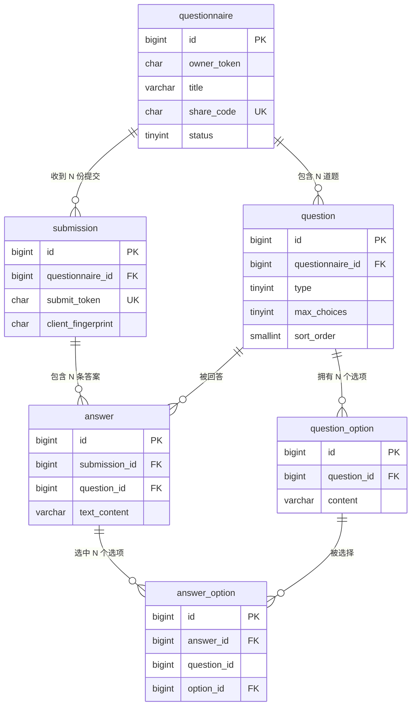

# 印象问答 · 数据库设计

关联：`01-产品需求文档.md`（第 4 章产品规则）、`04-API接口清单.md`

目标数据库：**MySQL 8.4**（本机已安装） / 引擎 InnoDB / 字符集 utf8mb4

---

## 1. 设计原则

1. **规范建模，不用 JSON 塞整份回答。**
   把「一整份问卷的所有答案」写进一个 JSON 或 TEXT 字段，第一版能跑，但一旦要做选项统计、分页、多用户隔离，就会变成灾难。这里用 6 张表把关系拆清楚。
2. **为「统计」而设计。** 这个产品的核心价值是汇总结果，所以索引要围绕「按问卷统计」「按题目统计」来建。
3. **可空字段用 NULL 表达「没有」，不用空字符串。** 例如未作答的开放题**不插入记录**，而不是插入空串。
4. **幂等优先。** 提交接口靠 `submit_token` 唯一索引实现「重复点击只产生一份答卷」，而不是靠前端防抖。
5. **第一版使用物理外键 + 级联删除。**
   教学价值高（关系完整性由数据库兜底），也让「删除问卷」只需一条 DELETE。
   生产环境常见做法是不建物理外键、改由应用层保证 + 定期校验，这一点在 §7 说明。

---

## 2. 实体关系（ER）



**关系白话版**

```
问卷 questionnaire
 ├── 题目 question ── 选项 question_option
 └── 提交 submission
        └── 答案 answer ── 选中的选项 answer_option
                └──（开放题的文本放在 answer.text_content）
```

---

## 3. 建库建表 DDL（可直接执行）

```sql
-- ============================================================
-- 印象问答 Impression · 初始化脚本
-- MySQL 8.4 / InnoDB / utf8mb4
-- ============================================================

CREATE DATABASE IF NOT EXISTS impression
  DEFAULT CHARACTER SET utf8mb4
  DEFAULT COLLATE utf8mb4_0900_ai_ci;

USE impression;

-- ------------------------------------------------------------
-- 1. 问卷
-- ------------------------------------------------------------
DROP TABLE IF EXISTS answer_option;
DROP TABLE IF EXISTS answer;
DROP TABLE IF EXISTS submission;
DROP TABLE IF EXISTS question_option;
DROP TABLE IF EXISTS question;
DROP TABLE IF EXISTS questionnaire;

CREATE TABLE questionnaire (
  id          BIGINT UNSIGNED NOT NULL AUTO_INCREMENT COMMENT '主键',
  owner_token CHAR(43)        NOT NULL                COMMENT '创建者凭证(Base64URL 编码的 32 字节随机数)，不唯一：同一个人可创建多份问卷',
  title       VARCHAR(30)     NOT NULL                COMMENT '问卷标题',
  description VARCHAR(100)    NOT NULL DEFAULT ''     COMMENT '问卷描述',
  share_code  CHAR(11)        NOT NULL                COMMENT '分享码(Base64URL 编码的 8 字节随机数)，用于公开链接 /u/{share_code}',
  status      TINYINT         NOT NULL DEFAULT 1      COMMENT '状态：1=进行中，2=已关闭',
  created_at  DATETIME(3)     NOT NULL DEFAULT CURRENT_TIMESTAMP(3),
  updated_at  DATETIME(3)     NOT NULL DEFAULT CURRENT_TIMESTAMP(3) ON UPDATE CURRENT_TIMESTAMP(3),
  PRIMARY KEY (id),
  UNIQUE KEY uk_questionnaire_share_code (share_code),
  KEY idx_questionnaire_owner (owner_token, created_at)
) ENGINE = InnoDB DEFAULT CHARSET = utf8mb4 COLLATE = utf8mb4_0900_ai_ci COMMENT = '问卷';

-- ------------------------------------------------------------
-- 2. 题目
-- ------------------------------------------------------------
CREATE TABLE question (
  id               BIGINT UNSIGNED NOT NULL AUTO_INCREMENT COMMENT '主键',
  questionnaire_id BIGINT UNSIGNED NOT NULL                COMMENT '所属问卷',
  type             TINYINT         NOT NULL                COMMENT '题型：1=单选，2=多选，3=开放题（4=排序题，预留）',
  title            VARCHAR(200)    NOT NULL                COMMENT '题干',
  description      VARCHAR(200)    NOT NULL DEFAULT ''     COMMENT '题干补充说明',
  required         TINYINT(1)      NOT NULL DEFAULT 1      COMMENT '是否必答：1=必答，0=可跳过',
  max_choices      TINYINT         NOT NULL DEFAULT 1      COMMENT '最多可选数：单选=1，多选=2~3，开放题=0',
  max_length       SMALLINT        NOT NULL DEFAULT 0      COMMENT '开放题字数上限，非开放题=0',
  sort_order       SMALLINT        NOT NULL DEFAULT 0      COMMENT '展示顺序，从 1 开始',
  created_at       DATETIME(3)     NOT NULL DEFAULT CURRENT_TIMESTAMP(3),
  updated_at       DATETIME(3)     NOT NULL DEFAULT CURRENT_TIMESTAMP(3) ON UPDATE CURRENT_TIMESTAMP(3),
  PRIMARY KEY (id),
  KEY idx_question_q_sort (questionnaire_id, sort_order),
  CONSTRAINT fk_question_questionnaire
    FOREIGN KEY (questionnaire_id) REFERENCES questionnaire (id) ON DELETE CASCADE
) ENGINE = InnoDB DEFAULT CHARSET = utf8mb4 COLLATE = utf8mb4_0900_ai_ci COMMENT = '题目';

-- ------------------------------------------------------------
-- 3. 选项
-- ------------------------------------------------------------
CREATE TABLE question_option (
  id          BIGINT UNSIGNED NOT NULL AUTO_INCREMENT COMMENT '主键',
  question_id BIGINT UNSIGNED NOT NULL                COMMENT '所属题目',
  content     VARCHAR(50)     NOT NULL                COMMENT '选项文案',
  sort_order  SMALLINT        NOT NULL DEFAULT 0      COMMENT '展示顺序',
  created_at  DATETIME(3)     NOT NULL DEFAULT CURRENT_TIMESTAMP(3),
  PRIMARY KEY (id),
  KEY idx_option_q_sort (question_id, sort_order),
  CONSTRAINT fk_option_question
    FOREIGN KEY (question_id) REFERENCES question (id) ON DELETE CASCADE
) ENGINE = InnoDB DEFAULT CHARSET = utf8mb4 COLLATE = utf8mb4_0900_ai_ci COMMENT = '题目的选项';

-- ------------------------------------------------------------
-- 4. 提交（一次完整答题）
-- ------------------------------------------------------------
CREATE TABLE submission (
  id                 BIGINT UNSIGNED NOT NULL AUTO_INCREMENT COMMENT '主键',
  questionnaire_id   BIGINT UNSIGNED NOT NULL                COMMENT '所属问卷',
  submit_token       CHAR(36)        NOT NULL                COMMENT '提交幂等键(UUID v4)，由前端生成；唯一索引保证重复点击只落一条',
  client_fingerprint CHAR(64)        NULL                    COMMENT 'IP+UA 的 SHA-256 十六进制摘要，仅用于风控去重，不存明文（默认不采集）',
  duration_ms        INT UNSIGNED    NULL                    COMMENT '答题耗时(毫秒)，用于产品分析',
  created_at         DATETIME(3)     NOT NULL DEFAULT CURRENT_TIMESTAMP(3),
  PRIMARY KEY (id),
  UNIQUE KEY uk_submission_token (submit_token),
  KEY idx_submission_q_created (questionnaire_id, created_at),
  KEY idx_submission_q_fingerprint (questionnaire_id, client_fingerprint),
  CONSTRAINT fk_submission_questionnaire
    FOREIGN KEY (questionnaire_id) REFERENCES questionnaire (id) ON DELETE CASCADE
) ENGINE = InnoDB DEFAULT CHARSET = utf8mb4 COLLATE = utf8mb4_0900_ai_ci COMMENT = '一次答题提交';

-- ------------------------------------------------------------
-- 5. 单题答案
-- ------------------------------------------------------------
CREATE TABLE answer (
  id            BIGINT UNSIGNED NOT NULL AUTO_INCREMENT COMMENT '主键',
  submission_id BIGINT UNSIGNED NOT NULL                COMMENT '所属提交',
  question_id   BIGINT UNSIGNED NOT NULL                COMMENT '对应题目',
  text_content  VARCHAR(200)    NULL                    COMMENT '开放题文本；选择题为 NULL。未作答则不插入记录',
  created_at    DATETIME(3)     NOT NULL DEFAULT CURRENT_TIMESTAMP(3),
  PRIMARY KEY (id),
  UNIQUE KEY uk_answer_submission_question (submission_id, question_id),
  KEY idx_answer_question (question_id),
  CONSTRAINT fk_answer_submission
    FOREIGN KEY (submission_id) REFERENCES submission (id) ON DELETE CASCADE,
  CONSTRAINT fk_answer_question
    FOREIGN KEY (question_id) REFERENCES question (id) ON DELETE CASCADE
) ENGINE = InnoDB DEFAULT CHARSET = utf8mb4 COLLATE = utf8mb4_0900_ai_ci COMMENT = '单题答案';

-- ------------------------------------------------------------
-- 6. 被选中的选项
-- ------------------------------------------------------------
CREATE TABLE answer_option (
  id          BIGINT UNSIGNED NOT NULL AUTO_INCREMENT COMMENT '主键',
  answer_id   BIGINT UNSIGNED NOT NULL                COMMENT '所属答案',
  question_id BIGINT UNSIGNED NOT NULL                COMMENT '冗余字段：便于直接按题目统计，省掉一次 join',
  option_id   BIGINT UNSIGNED NOT NULL                COMMENT '被选中的选项',
  sort_no     TINYINT         NULL                    COMMENT '预留：排序题的位次；单选/多选为 NULL',
  created_at  DATETIME(3)     NOT NULL DEFAULT CURRENT_TIMESTAMP(3),
  PRIMARY KEY (id),
  UNIQUE KEY uk_answer_option (answer_id, option_id),
  KEY idx_ao_option (option_id),
  KEY idx_ao_question (question_id),
  CONSTRAINT fk_ao_answer
    FOREIGN KEY (answer_id) REFERENCES answer (id) ON DELETE CASCADE,
  CONSTRAINT fk_ao_question
    FOREIGN KEY (question_id) REFERENCES question (id) ON DELETE CASCADE,
  CONSTRAINT fk_ao_option
    FOREIGN KEY (option_id) REFERENCES question_option (id) ON DELETE CASCADE
) ENGINE = InnoDB DEFAULT CHARSET = utf8mb4 COLLATE = utf8mb4_0900_ai_ci COMMENT = '被选中的选项';
```

> **关于 `answer_option.question_id` 这个冗余字段**：统计「某题各选项票数」是最热的查询。保留 `question_id` 后可以直接按它过滤/索引，不必回 join `answer`。代价是写入时要保证一致性（由 Service 层在同一事务内赋值），属于**有意识的、代价可控的反范式**——面试里能讲清楚「为什么冗余、怎么保证一致」比不冗余更加分。

---

## 4. 数据字典

### 4.1 `questionnaire` 问卷

| 字段 | 类型 | 空 | 默认 | 说明 |
|---|---|---|---|---|
| id | BIGINT UNSIGNED | 否 | 自增 | 主键 |
| owner_token | CHAR(43) | 否 | — | 创建者凭证。同一创建者多份问卷共用一个 token |
| title | VARCHAR(30) | 否 | — | 标题 |
| description | VARCHAR(100) | 否 | '' | 描述 |
| share_code | CHAR(11) | 否 | — | 分享码，公开链接使用；**必须不可预测** |
| status | TINYINT | 否 | 1 | 1=进行中 2=已关闭 |
| created_at / updated_at | DATETIME(3) | 否 | 当前时间 | 毫秒精度 |

### 4.2 `question` 题目

| 字段 | 类型 | 说明 |
|---|---|---|
| type | TINYINT | 1=单选 2=多选 3=开放题（4=排序题预留） |
| required | TINYINT(1) | 1=必答 0=可跳过 |
| max_choices | TINYINT | 单选固定 1；多选 2–3；开放题 0 |
| max_length | SMALLINT | 开放题上限 200；其余 0 |
| sort_order | SMALLINT | 从 1 开始，决定展示顺序 |

### 4.3 `submission` 提交

| 字段 | 类型 | 说明 |
|---|---|---|
| submit_token | CHAR(36) | 前端生成的 UUID v4，**幂等键** |
| client_fingerprint | CHAR(64) | IP+UA 的 SHA-256；**默认不写入**，仅在开启风控时使用 |
| duration_ms | INT UNSIGNED | 从「开始答题」到「提交」的耗时，用于分析题目流失 |

### 4.4 枚举值集中定义

| 枚举 | 值 |
|---|---|
| `questionnaire.status` | 1 进行中 · 2 已关闭 |
| `question.type` | 1 单选 · 2 多选 · 3 开放题 · 4 排序题（预留） |
| `question.required` | 1 必答 · 0 可跳过 |

> 建议在 Java 侧用 `enum` + `@EnumValue`（MyBatis-Plus）或 `TypeHandler` 映射，不要到处写魔法数字。

---

## 5. 索引设计与关键 SQL

### 5.1 索引清单与理由

| 索引 | 服务于什么查询 |
|---|---|
| `uk_questionnaire_share_code` | 答题者用分享码查问卷（**最高频**） |
| `idx_questionnaire_owner (owner_token, created_at)` | 创建者管理页列出自己的问卷 |
| `idx_question_q_sort (questionnaire_id, sort_order)` | 按问卷取题目并排序 |
| `idx_option_q_sort (question_id, sort_order)` | 按题目取选项并排序 |
| `uk_submission_token` | 提交幂等（防重复提交的**核心**） |
| `idx_submission_q_created (questionnaire_id, created_at)` | 统计提交总数、按时间倒序分页 |
| `uk_answer_submission_question` | 防止同一次提交对同一题写入两条答案 |
| `idx_answer_question` | 取某题的开放题回答列表 |
| `idx_ao_option` | 某题各选项票数统计 |
| `idx_ao_question` | 某题的总作答人数 |

### 5.2 关键查询 SQL

**Q1. 某题各选项得票（统计页核心）**

```sql
SELECT o.id,
       o.content,
       COUNT(ao.id) AS votes
FROM question_option o
LEFT JOIN answer_option ao ON ao.option_id = o.id
WHERE o.question_id = ?
GROUP BY o.id, o.content, o.sort_order
ORDER BY votes DESC, o.sort_order ASC;
```
> 用 `LEFT JOIN` 是为了让 **0 票的选项也出现**，否则统计图会缺项。

**Q2. 某题的有效作答人数（用于算百分比分母）**

```sql
SELECT COUNT(*) FROM answer WHERE question_id = ?;
```

**Q3. 某问卷的提交总数与最近提交时间**

```sql
SELECT COUNT(*) AS total, MAX(created_at) AS last_at
FROM submission
WHERE questionnaire_id = ?;
```

**Q4. 开放题回答（分页，倒序）**

```sql
SELECT a.id, a.text_content, s.created_at
FROM answer a
JOIN submission s ON s.id = a.submission_id
WHERE a.question_id = ?
  AND a.text_content IS NOT NULL
  AND a.text_content <> ''
ORDER BY s.created_at DESC
LIMIT 10 OFFSET 0;
```

**Q5. 创建者的问卷列表 + 各自提交数**

```sql
SELECT q.id, q.title, q.status, q.share_code, q.created_at,
       (SELECT COUNT(*) FROM submission s WHERE s.questionnaire_id = q.id) AS submission_count
FROM questionnaire q
WHERE q.owner_token = ?
ORDER BY q.created_at DESC;
```

**Q6. 某道多选题的平均选择数（分析用）**

```sql
SELECT ROUND(AVG(cnt), 2) AS avg_choices
FROM (
  SELECT ao.answer_id, COUNT(*) AS cnt
  FROM answer_option ao
  WHERE ao.question_id = ?
  GROUP BY ao.answer_id
) t;
```

### 5.3 一次提交的写入事务（伪代码，务必在一个事务内）

```
BEGIN;
  1. 校验问卷存在且 status = 1                 -- SELECT ... WHERE share_code = ? FOR SHARE
  2. 校验题目属于该问卷、选项属于对应题目        -- 防伪造 option_id
  3. INSERT INTO submission (submit_token, questionnaire_id, duration_ms, ...)
        -- 若触发 uk_submission_token 唯一冲突 → 回滚并返回「已提交过」，实现幂等
  4. 对每道已作答的题：
       INSERT INTO answer (submission_id, question_id, text_content)
       取得 answer.id
       若为选择题：批量 INSERT INTO answer_option (answer_id, question_id, option_id)
COMMIT;
```
> 第 1 步校验问卷状态与第 3 步写入必须在同一事务内，否则会出现「刚检查完就被人关闭了问卷」的竞态。

---

## 6. 种子数据（MVP 的 9 道预置题）

```sql
-- 一份示例问卷
INSERT INTO questionnaire (owner_token, title, description, share_code, status)
VALUES ('REPLACE_WITH_YOUR_OWNER_TOKEN', '维嘉的印象问答', '花 1 分钟，告诉我你眼中的我是什么样的人',
        'demoShare01', 1);

SET @qid = LAST_INSERT_ID();

-- Q1 单选：第一印象
INSERT INTO question (questionnaire_id, type, title, required, max_choices, sort_order)
VALUES (@qid, 1, '你第一次见我时，觉得我是一个什么样的人？', 1, 1, 1);
SET @q1 = LAST_INSERT_ID();
INSERT INTO question_option (question_id, content, sort_order) VALUES
  (@q1, '安静、有点慢热', 1),
  (@q1, '健谈、比较外向', 2),
  (@q1, '看起来很有想法', 3),
  (@q1, '随和、好相处', 4),
  (@q1, '说不清楚，没太多印象', 5);

-- Q2 多选：最突出的特质（最多选 3）
INSERT INTO question (questionnaire_id, type, title, required, max_choices, sort_order)
VALUES (@qid, 2, '你觉得我最突出的三个特点是什么？（最多选 3 项）', 1, 3, 2);
SET @q2 = LAST_INSERT_ID();
INSERT INTO question_option (question_id, content, sort_order) VALUES
  (@q2, '独立，有自己的想法', 1),
  (@q2, '幽默，会活跃气氛', 2),
  (@q2, '理性，喜欢分析问题', 3),
  (@q2, '细心，会照顾人', 4),
  (@q2, '好奇心强，爱研究新东西', 5),
  (@q2, '敏感，想得比较多', 6),
  (@q2, '有野心，目标明确', 7),
  (@q2, '随性，不太计较', 8);

-- Q3 开放题（可跳过，上限 200 字）
INSERT INTO question (questionnaire_id, type, title, required, max_choices, max_length, sort_order)
VALUES (@qid, 3, '有什么一直想对我说、却没说过的话吗？', 0, 0, 200, 9);
```

> 完整 9 题按同样格式补齐（4–5 道单选 + 2–3 道多选 + 1–2 道开放题），配比见 `01-产品需求文档.md` §4.1。

---

## 7. 反范式与优化（先说清楚，别提前做）

| 方向 | 做法 | 什么时候才做 |
|---|---|---|
| 提交数缓存 | 在 `questionnaire` 上加 `submission_count` 字段，写入时同事务 +1 | 管理页列表查询变慢时 |
| 统计结果缓存 | 统计结果写 Redis，提交时失效 | 单问卷提交量 > 1000 且统计接口 P95 > 1s |
| 去掉物理外键 | 改由应用层保证 + 定时脚本校验孤儿数据 | 数据量变大、需要分库分表时 |
| 归档冷数据 | 超过 1 年的 submission/answer 归档到历史表 | 单表 > 500 万行 |

> ⚠️ **第一版一个都不要做。** 这些是「有了真实压力再优化」的选项，提前做只会增加 bug 面。面试时能说出「我评估过但选择不做，因为当前 QPS 只有个位数」比堆技术更有说服力。

---

## 8. 变更管理

- 所有 DDL 与种子数据以 `sql/` 目录下的脚本形式入库（`sql/V1__init_schema.sql`、`sql/V2__seed_questions.sql`）。
- 每次改表都新增一个脚本文件，**不要直接改已执行过的脚本**。
- 后续可引入 Flyway 自动管理版本（Boot 4 有官方 starter），第一版手动执行即可。
