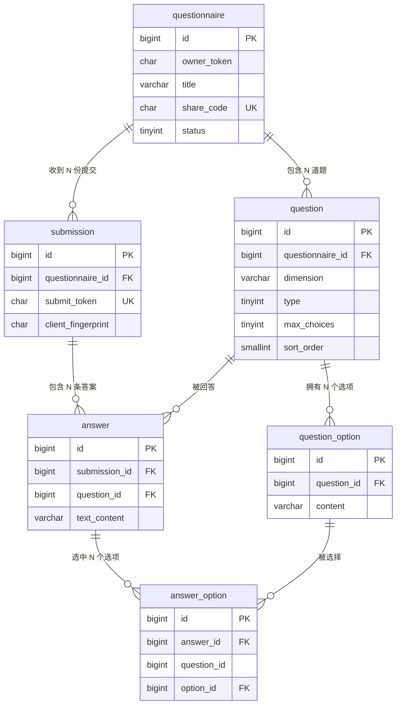

# 印象问答 · 数据库设计

关联：`01-产品需求文档.md`（第 4 章产品规则）、`04-API接口清单.md`

目标数据库：**MySQL 8.4**（本机已安装） / 引擎 InnoDB / 字符集 utf8mb4

---

## 1. 设计原则

1. **规范建模，不用 JSON 塞整份回答。**
   把「一整份问卷的所有答案」写进一个 JSON 或 TEXT 字段，第一版能跑，但一旦要做选项统计、分页、多用户隔离，就会变成灾难。这里用 6 张表把关系拆清楚。
2. **为「统计」而设计。** 这个产品的核心价值是汇总结果，所以索引要围绕「按问卷统计」「按题目统计」来建。
3. **可空字段用 NULL 表达「没有」，不用空字符串。** 例如未作答的开放题**不插入记录**，而不是插入空串。
4. **幂等优先。** 提交接口靠 `submit_token` 唯一索引实现「重复点击只产生一份答卷」，而不是靠前端防抖。
5. **第一版使用物理外键 + 级联删除。**
   教学价值高（关系完整性由数据库兜底），也让「删除问卷」只需一条 DELETE。
   生产环境常见做法是不建物理外键、改由应用层保证 + 定期校验，这一点在 §7 说明。

---

## 2. 实体关系（ER）



**关系白话版**

```
问卷 questionnaire
 ├── 题目 question ── 选项 question_option
 └── 提交 submission
        └── 答案 answer ── 选中的选项 answer_option
                └──（自由 / 自定义答案文本放在 answer.text_content）
```

---

## 3. 建库建表 DDL

> **完整可执行脚本在 `sql/V1__init_schema.sql`（唯一权威版本）。**
> 本文档不再重复贴一份 DDL —— 两处各存一份必然改得不同步。
> 执行方式：MySQL Workbench → 新建 Query Tab → 全选粘贴 → 点执行。
> 该脚本第 0 步是 `DROP DATABASE IF EXISTS impression`，所以可重复执行；
> **收到真实回答数据之后就不要再跑它**，改成增量 `ALTER` 脚本（约定见 §8）。

六张表的分工：

| 表 | 表意 | 关键索引 / 约束 |
|---|---|---|
| `questionnaire` | 问卷主体，一个创建者可有多份 | `uk_questionnaire_share_code`（答题入口）、`idx_questionnaire_owner` |
| `question` | 题目 | `idx_question_q_sort (questionnaire_id, sort_order)` |
| `question_option` | 题目的预设选项 | `idx_option_q_sort (question_id, sort_order)` |
| `submission` | 一次完整答题 | `uk_submission_token` —— **幂等的核心** |
| `answer` | 某人对某题的作答（跳过的题不写行） | `uk_answer_submission_question` |
| `answer_option` | 该次作答勾选了哪些选项 | `idx_ao_option`、`idx_ao_question` |

**v2.0 题型统一带来的字段语义变化**（表结构零改动，理由见 `07-题型统一-影响评估.md`）：

| 字段 | 新语义 |
|---|---|
| `question.dimension` | **新增字段**：所属维度（第一印象 / 相处体验 / 性格特征 / 关系认知），结果页按它分组 |
| `question.type` | 1 = 有预设选项，2 = 纯自由填写（**不再**表示单选 / 多选 / 开放） |
| `question.max_choices` | 默认 `0` = 不限。**旧默认值是 1，沿用会让"多选"静默失效** |
| `question.max_length` | 默认 200；`0` = 不允许自定义答案 |
| `question.required` | 恒为 `0`（全局可跳过），字段保留仅供将来恢复差异化设置 |
| `answer.text_content` | 任何题型都可能填（不再限于开放题）；未填为 NULL |

> **`answer_option.question_id` 这个冗余字段**：统计「某题各选项票数」是最热的查询，保留 `question_id` 后可以直接按它过滤 / 建索引，不必回 join `answer`。代价是写入时要保证一致性（由 Service 层在同一事务内赋值）。这属于**有意识的、代价可控的反范式** —— 面试里能讲清楚「为什么冗余、怎么保证一致」，比不冗余更加分。

> **关于 `answer_option.question_id` 这个冗余字段**：统计「某题各选项票数」是最热的查询。保留 `question_id` 后可以直接按它过滤/索引，不必回 join `answer`。代价是写入时要保证一致性（由 Service 层在同一事务内赋值），属于**有意识的、代价可控的反范式**——面试里能讲清楚「为什么冗余、怎么保证一致」比不冗余更加分。

---

## 4. 数据字典

### 4.1 `questionnaire` 问卷

| 字段 | 类型 | 空 | 默认 | 说明 |
|---|---|---|---|---|
| id | BIGINT UNSIGNED | 否 | 自增 | 主键 |
| owner_token | CHAR(43) | 否 | — | 创建者凭证。同一创建者多份问卷共用一个 token |
| title | VARCHAR(30) | 否 | — | 标题 |
| description | VARCHAR(100) | 否 | '' | 描述 |
| share_code | CHAR(11) | 否 | — | 分享码，公开链接使用；**必须不可预测** |
| status | TINYINT | 否 | 1 | 1=进行中 2=已关闭 |
| created_at / updated_at | DATETIME(3) | 否 | 当前时间 | 毫秒精度 |

### 4.2 `question` 题目

| 字段 | 类型 | 说明 |
|---|---|---|
| dimension | VARCHAR(20) | 所属维度：第一印象 / 相处体验 / 性格特征 / 关系认知。结果页按它分组 |
| type | TINYINT | 1 = 有预设选项 · 2 = 纯自由填写（**v2.0 起不再表示单选 / 多选 / 开放**） |
| required | TINYINT | 1 = 必答 · 0 = 可跳过。**v2.0 起恒为 0** |
| max_choices | TINYINT | **0 = 不限**；需要限制时设 2–3 |
| max_length | SMALLINT | 自定义答案字数上限，默认 200；0 = 不允许自定义 |
| sort_order | SMALLINT | 从 1 开始，决定展示顺序 |

### 4.3 `submission` 提交

| 字段 | 类型 | 说明 |
|---|---|---|
| submit_token | CHAR(36) | 前端生成的 UUID v4，**幂等键** |
| client_fingerprint | CHAR(64) | IP+UA 的 SHA-256；**默认不写入**，仅在开启风控时使用 |
| duration_ms | INT UNSIGNED | 从「开始答题」到「提交」的耗时，用于分析题目流失 |

### 4.4 枚举值集中定义

| 枚举 | 值 |
|---|---|
| `questionnaire.status` | 1 进行中 · 2 已关闭 |
| `question.type` | 1 有预设选项 · 2 纯自由填写 |
| `question.required` | 1 必答 · 0 可跳过（v2.0 起恒为 0） |

> 建议在 Java 侧用 `enum` + `@EnumValue`（MyBatis-Plus）或 `TypeHandler` 映射，不要到处写魔法数字。

---

## 5. 索引设计与关键 SQL

### 5.1 索引清单与理由

| 索引 | 服务于什么查询 |
|---|---|
| `uk_questionnaire_share_code` | 答题者用分享码查问卷（**最高频**） |
| `idx_questionnaire_owner (owner_token, created_at)` | 创建者管理页列出自己的问卷 |
| `idx_question_q_sort (questionnaire_id, sort_order)` | 按问卷取题目并排序 |
| `idx_option_q_sort (question_id, sort_order)` | 按题目取选项并排序 |
| `uk_submission_token` | 提交幂等（防重复提交的**核心**） |
| `idx_submission_q_created (questionnaire_id, created_at)` | 统计提交总数、按时间倒序分页 |
| `uk_answer_submission_question` | 防止同一次提交对同一题写入两条答案 |
| `idx_answer_question` | 取某题的开放题回答列表 |
| `idx_ao_option` | 某题各选项票数统计 |
| `idx_ao_question` | 某题的总作答人数 |

### 5.2 关键查询 SQL

**Q1. 某题各选项得票（统计页核心）**

```sql
SELECT o.id,
       o.content,
       COUNT(ao.id) AS votes
FROM question_option o
LEFT JOIN answer_option ao ON ao.option_id = o.id
WHERE o.question_id = ?
GROUP BY o.id, o.content, o.sort_order
ORDER BY votes DESC, o.sort_order ASC;
```
> 用 `LEFT JOIN` 是为了让 **0 票的选项也出现**，否则统计图会缺项。

**Q2. 某题的有效作答人数（用于算百分比分母）**

```sql
SELECT COUNT(*) FROM answer WHERE question_id = ?;
```

**Q3. 某问卷的提交总数与最近提交时间**

```sql
SELECT COUNT(*) AS total, MAX(created_at) AS last_at
FROM submission
WHERE questionnaire_id = ?;
```

**Q4. 开放题回答（分页，倒序）**

```sql
SELECT a.id, a.text_content, s.created_at
FROM answer a
JOIN submission s ON s.id = a.submission_id
WHERE a.question_id = ?
  AND a.text_content IS NOT NULL
  AND a.text_content <> ''
ORDER BY s.created_at DESC
LIMIT 10 OFFSET 0;
```

**Q5. 创建者的问卷列表 + 各自提交数**

```sql
SELECT q.id, q.title, q.status, q.share_code, q.created_at,
       (SELECT COUNT(*) FROM submission s WHERE s.questionnaire_id = q.id) AS submission_count
FROM questionnaire q
WHERE q.owner_token = ?
ORDER BY q.created_at DESC;
```

**Q6. 某道多选题的平均选择数（分析用）**

```sql
SELECT ROUND(AVG(cnt), 2) AS avg_choices
FROM (
  SELECT ao.answer_id, COUNT(*) AS cnt
  FROM answer_option ao
  WHERE ao.question_id = ?
  GROUP BY ao.answer_id
) t;
```

### 5.3 一次提交的写入事务（伪代码，务必在一个事务内）

```
BEGIN;
  1. 校验问卷存在且 status = 1                 -- SELECT ... WHERE share_code = ? FOR SHARE
  2. 校验题目属于该问卷、选项属于对应题目        -- 防伪造 option_id
  3. INSERT INTO submission (submit_token, questionnaire_id, duration_ms, ...)
        -- 若触发 uk_submission_token 唯一冲突 → 回滚并返回「已提交过」，实现幂等
  4. 对每道已作答的题：
       INSERT INTO answer (submission_id, question_id, text_content)
       取得 answer.id
       若为选择题：批量 INSERT INTO answer_option (answer_id, question_id, option_id)
COMMIT;
```
> 第 1 步校验问卷状态与第 3 步写入必须在同一事务内，否则会出现「刚检查完就被人关闭了问卷」的竞态。

---

## 6. 种子数据

> **完整脚本在 `sql/V2__seed_questions.sql`**：1 份示例问卷 + **11 道题 / 40 个预设选项**，与 `prototype/index.html` 顶部的 `QUESTIONS` 数组**逐字一致**（已用脚本逐条比对通过）。题库本身的设计与取舍见 `06-题库设计.md`（v2.0）。

脚本会写入一组随机的 `owner_token` 和 `share_code`，执行完请把最后那个 SELECT 的结果抄下来：

| 值 | 用途 |
|---|---|
| `share_code` | 答题链接 `/u/{share_code}`；也是调用公开接口时要传的值 |
| `owner_token` | 管理接口的凭证（`X-Owner-Token` 请求头）。**丢了就找不回这份问卷** |

> 想改题目：直接编辑 `sql/V2__seed_questions.sql` 后重跑 V1 + V2 即可（开发期最省事）。
> 收到真实回答后就不要重跑了，改为写增量 `ALTER` / `UPDATE` 脚本。

---

## 7. 反范式与优化（先说清楚，别提前做）

| 方向 | 做法 | 什么时候才做 |
|---|---|---|
| 提交数缓存 | 在 `questionnaire` 上加 `submission_count` 字段，写入时同事务 +1 | 管理页列表查询变慢时 |
| 统计结果缓存 | 统计结果写 Redis，提交时失效 | 单问卷提交量 > 1000 且统计接口 P95 > 1s |
| 去掉物理外键 | 改由应用层保证 + 定时脚本校验孤儿数据 | 数据量变大、需要分库分表时 |
| 归档冷数据 | 超过 1 年的 submission/answer 归档到历史表 | 单表 > 500 万行 |

> ⚠️ **第一版一个都不要做。** 这些是「有了真实压力再优化」的选项，提前做只会增加 bug 面。面试时能说出「我评估过但选择不做，因为当前 QPS 只有个位数」比堆技术更有说服力。

---

## 8. 变更管理

- 所有 DDL 与种子数据以 `sql/` 目录下的脚本形式入库（`sql/V1__init_schema.sql`、`sql/V2__seed_questions.sql`）。
- 每次改表都新增一个脚本文件，**不要直接改已执行过的脚本**。
- 后续可引入 Flyway 自动管理版本（Boot 4 有官方 starter），第一版手动执行即可。
